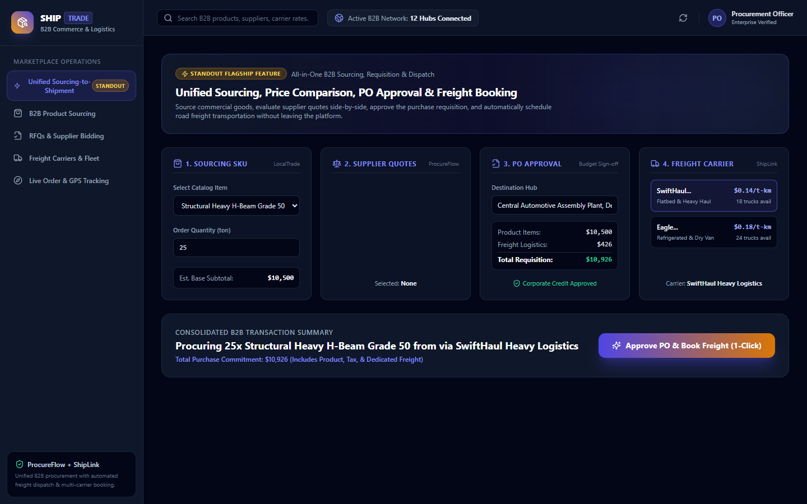

# Smart Business Marketplace (`ShipLink` + `LocalTrade` + `ProcureFlow`)

[](https://nodejs.org/)
[](https://expressjs.com/)
[](https://react.dev/)
[](https://tailwindcss.com/)
[](https://www.docker.com/)

A unified **B2B Commerce, Enterprise Procurement & Multi-Carrier Freight Logistics Platform** that merges commercial goods sourcing, competitive quotation bidding, purchase order approvals, and end-to-end freight dispatch into one cohesive workflow.

---

## 📸 Working System Preview



## 📊 Kaggle & Production Supply Chain Datasets

The platform is pre-loaded with commercial B2B procurement and freight logistics benchmarks modeled after Kaggle Supply Chain & Freight Logistics datasets:
- [`kaggle_b2b_procurement_freight_benchmark.csv`](data/kaggle_b2b_procurement_freight_benchmark.csv): Real industrial SKUs across steel beams, polymer resins, sensor ICs, and heavy-duty corrugated containers, RFQs, winning vendor quotation pricing, commercial motor carrier linehauls (Chicago–Detroit, San Jose–Austin), freight pricing calculations, and active order waybill tracking.

---

## 🌟 Standout Feature: Unified Sourcing-to-Shipment Flow

In traditional supply chains, sourcing products, negotiating supplier quotes, getting requisition approval, and coordinating transportation carriers are isolated across 3 to 4 distinct software tools.

**ShipTrade unifies this entire lifecycle in a single platform:**
1. **Source Commercial SKU**: Select items from verified industrial and B2B vendor catalogues.
2. **Compare Live Supplier Quotes**: Evaluate competitive bids side-by-side with transparent unit costs, payment terms, and vendor reliability scores.
3. **1-Click Purchase Requisition Approval**: Sign off on purchase orders with automated corporate credit validation.
4. **Instant Freight Carrier Booking**: Dispatch commercial motor carriers (flatbeds, dry vans, intermodal) and instantly generate live waypoints with GPS-backed tracking numbers (`SLK-XXXX`).

---

## 🏗️ Architecture

```
                                  ┌──────────────────────────────┐
                                  │   React 18 + Tailwind UI     │
                                  │  - Unified Sourcing Cockpit  │
                                  │  - B2B Product Catalogue     │
                                  │  - RFQ & Quote Comparator    │
                                  │  - Carrier Fleet & Waypoints │
                                  └──────────────┬───────────────┘
                                                 │ HTTP / JSON
                                                 ▼
                                  ┌──────────────────────────────┐
                                  │   Express REST API Gateway   │
                                  │        (/api/v1/*)           │
                                  └──────────────┬───────────────┘
                                                 │
                   ┌─────────────────────────────┼─────────────────────────────┐
                   ▼                             ▼                             ▼
       ┌──────────────────────┐      ┌──────────────────────┐      ┌──────────────────────┐
       │   LocalTrade Module  │      │  ProcureFlow Module  │      │   ShipLink Logistics │
       │  - Catalog & SKUs    │      │  - RFQs & Quotes     │      │  - Carrier Fleets    │
       │  - Verified Vendors  │      │  - PO Requisitions   │      │  - GPS Telemetry     │
       └──────────────────────┘      └──────────────────────┘      └──────────────────────┘
```

---

## 🚀 Quickstart

### Option 1: Docker Compose (Recommended)
```bash
git clone https://github.com/Prasunnandi/smart-business-marketplace.git
cd smart-business-marketplace
docker-compose up --build
```
- Frontend UI: `http://localhost:3000`
- API Backend: `http://localhost:5000/api/v1/health`

### Option 2: Local Development

#### 1. Backend (Express)
```bash
cd backend
npm install
npm run dev
```

#### 2. Frontend (React + Vite)
```bash
cd frontend
npm install
npm run dev
```

---

## 📡 REST API Reference

| Endpoint | Method | Description |
| :--- | :---: | :--- |
| `/api/v1/products` | `GET` | List catalog products with wholesale volume tiers |
| `/api/v1/suppliers` | `GET` | Retrieve verified supplier directory with reliability ratings |
| `/api/v1/rfqs` | `GET` / `POST` | Query active RFQs or broadcast a new buyer quotation request |
| `/api/v1/transporters` | `GET` | View available freight motor carriers and rate per ton-km |
| `/api/v1/shipments` | `GET` | Query active in-transit consignments with GPS coordinates |
| `/api/v1/marketplace/unified-procure-and-ship` | `POST` | **Standout Feature**: Execute unified 4-in-1 sourcing, quotation selection, PO approval, and freight dispatch |

---

## 📜 License
Distributed under the MIT License.
